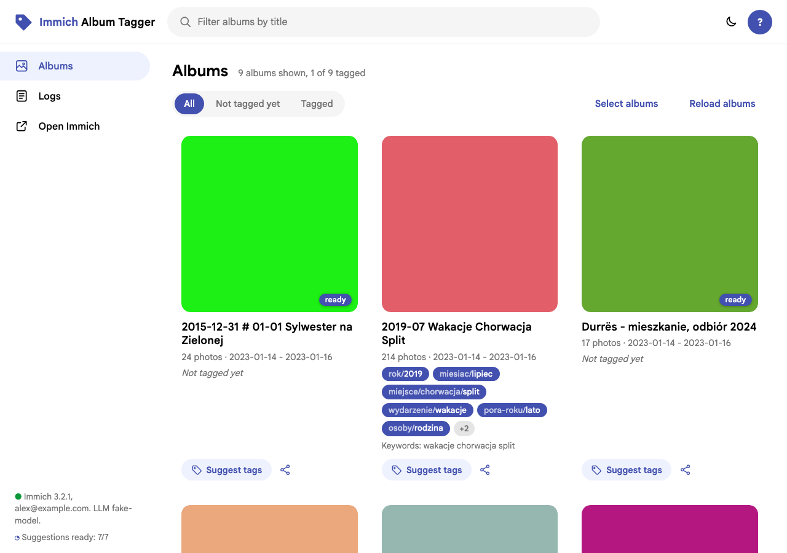

# Immich Album Tagger

A small companion web app for [Immich](https://immich.app). It reads your album titles,
suggests tags (from rules and, optionally, a local LLM), lets you review and edit them,
and applies them to **every photo in the album** in one click.

Immich has no "album tags" and tags photos only by selection. If your library is already
organised into hundreds of albums, this moves that knowledge onto the photos.



## Features

- Suggestion variants per album: album name, regex rules (year, month, event...), title
  keywords, and several LLM proposals. Pick one, merge them, edit, add your own.
- Hierarchical tags (`miejsce/chorwacja/split`), autocomplete from existing Immich tags.
- Write to any combination of: Immich tags on photos, a `#tag` line in photo descriptions
  (searchable by everyone who can see the photos), a keyword line in the album description
  (found on the *Albums* page, also by people the album is shared with).
- Album keywords with base forms from the LLM ("Zielonej" -> "zielona") and related words.
- Share albums with other Immich users from the same screen.
- Verification a few seconds after applying, with a clear warning when Immich reverts
  changes (read-only external libraries) or skips photos of other owners.
- Remembers which albums were tagged and with what. Applying again changes the tags (tags
  taken out of the selection come off the photos); *Remove tagging* takes everything back.
- CLI for bulk work: export suggestions for all albums to JSON, edit, apply.
- Any OpenAI-compatible LLM endpoint (llama.cpp, vLLM, Ollama, LiteLLM, OpenAI) — or none.
- Works with Immich before and after the 3.2 search API change.
- Fast mode: panels close at once, results arrive as notifications; every action is
  written to an operation log with its own page.
- Login with Immich accounts; optionally everyone works on their own account through a
  temporary API key created at login and deleted at logout. Or a login from hashed
  credentials. English and Polish UI from editable `.lan` files.
- Looks like Immich: album cards, colors and font read from the running Immich (they follow
  Immich upgrades), light / dark mode shared with Immich. Runs on its own
  host name or under a path of Immich's, e.g. `https://immich.example.com/IAT/`, with no
  setting changed (reverse proxy examples in the admin guide).
- One container, no database server, no frontend build.

## Configuration

`config/` holds the files used by default and a fully commented `*.example` for each of them
(`immich`, `llm`, `tagging`, `app`, `credentials`) listing every setting with its default,
plus `nginx-reverse-proxy.conf.example` (own host name, or a path like `/IAT/` of Immich's).
Secrets go into `.env` (see `.env.example`).

## Quick start (Docker)

```bash
cp .env.example .env          # set IMMICH_URL, IMMICH_API_KEY, LLM_* (or LLM_ENABLED=false)
cp docker-compose.yml.example docker-compose.yml   # adjust ports, volumes, image
docker compose run --rm immich-album-tagger check   # verify connections
docker compose up -d
```

Open `http://<host>:8080`.

## Quick start (local)

```bash
make install                  # .venv + dependencies
cp .env.example .env          # fill in
make check                    # verify connections
make run                      # http://127.0.0.1:8080
```

Try the UI without touching your library: `make dev` starts a fake Immich and a fake LLM.

## Documentation

| Document | For |
| --- | --- |
| [PROJECT.md](PROJECT.md) | Why the project exists, use cases, requirements, roadmap |
| [docs/USER_GUIDE.md](docs/USER_GUIDE.md) | Tagging albums in the UI and with the CLI |
| [docs/ADMIN_GUIDE.md](docs/ADMIN_GUIDE.md) | Install, configuration reference, security, upgrades, troubleshooting |
| [docs/DEVELOPER.md](docs/DEVELOPER.md) | Architecture, code map, testing, extending, releasing |
| [CHANGELOG.md](CHANGELOG.md) | What changed between versions |

## Source, issues and contributions

Development happens in the maintainer's own Gitea; this GitHub repository is an automatic
mirror of it, and every release tag here publishes the Docker Hub image
[`kamileczek123/immich-album-tagger`](https://hub.docker.com/r/kamileczek123/immich-album-tagger).
Issues and pull requests are welcome on GitHub. Pull requests are not merged here (the next
mirror sync would overwrite them) but applied upstream, then they appear here with the
next sync.

## License

[MIT](LICENSE).

## Trademark

Immich Album Tagger is an independent project. It is not affiliated with or endorsed by
Immich or FUTO. Immich is a trademark of FUTO. The app only talks to your Immich server
through its public REST API; it contains no Immich code or logo.

## Requirements

- Immich with an API key **of the account that owns the photos** (permissions in the admin
  guide). Photos in external libraries need a writable library folder.
- Docker, or Python 3.11+.
- Optional: an OpenAI-compatible LLM endpoint.
