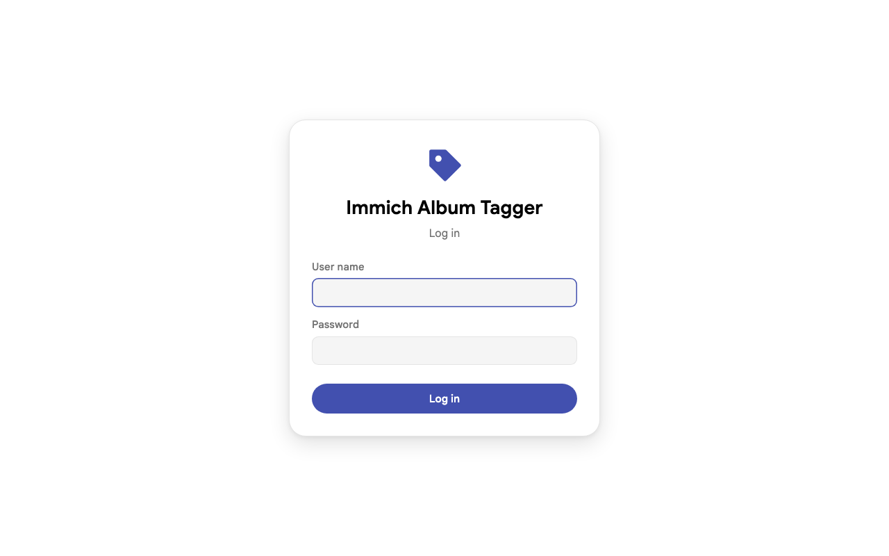
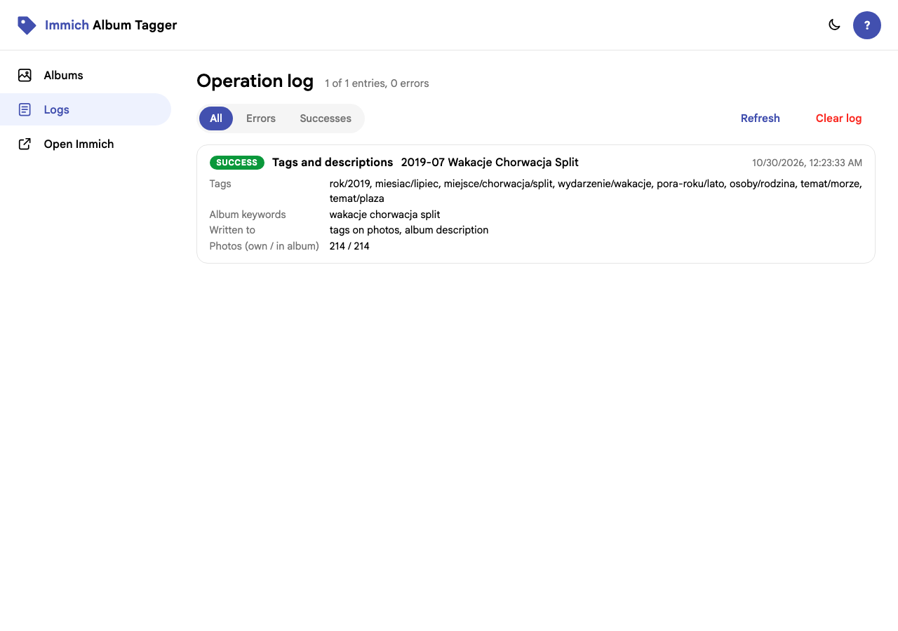
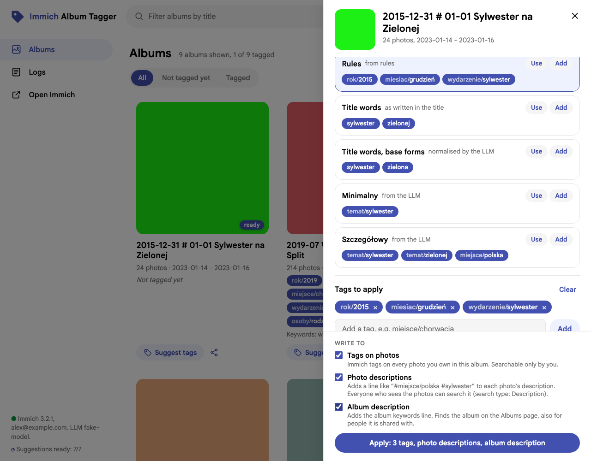
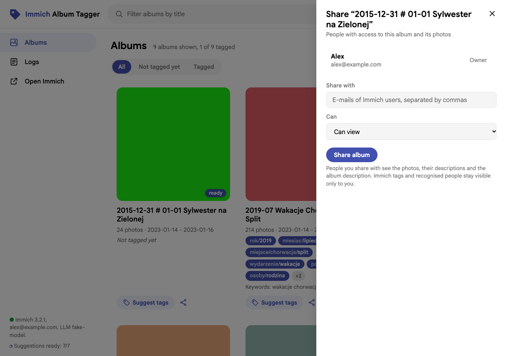
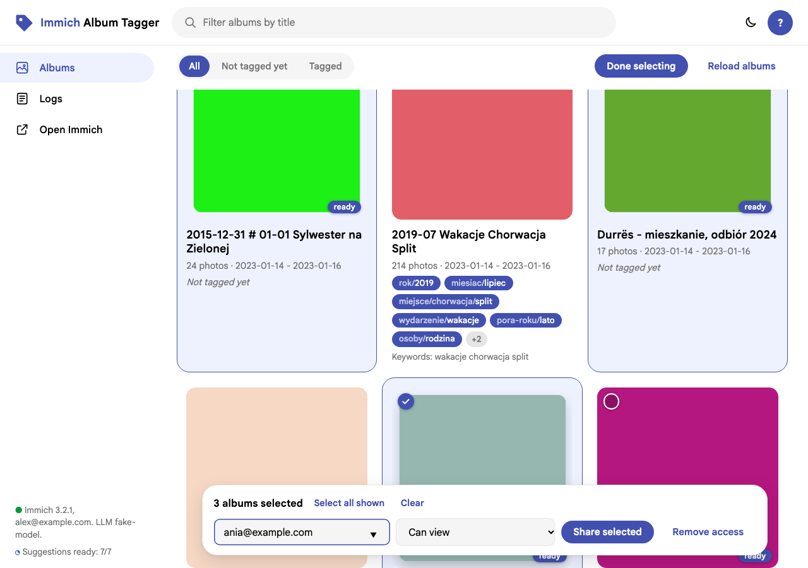

# User guide

This guide is for the person tagging and sharing albums. Installation and configuration are
in the [admin guide](ADMIN_GUIDE.md).

## What the app does

For one album at a time you choose tags and keywords, and the app writes them to Immich in
up to three places:

| Target | What is written | Who can search by it |
| --- | --- | --- |
| **Tags on photos** | Immich tags on every photo of the album | only you (tags belong to your account) |
| **Photo descriptions** | one line like `#czas/rok/2015 #miejsce/polska` in each photo's description | everyone who can see the photo |
| **Album description** | one line like `Słowa kluczowe: sylwester zielona nowy rok` | everyone who sees the album, on the *Albums* page |

The app only **adds** and **replaces its own lines**. Your own description text is kept;
photos, albums and tags are never deleted.

Only photos **you own** can be changed. In an album that others added photos to, their
photos are skipped and the result tells you how many.

## Logging in and language

If your administrator set up a login, the app opens with a login page. Depending on the
setup you log in either with **the e-mail and password of your Immich account** (the page
says so) or with a user name and password set up for the tagger. The top right corner shows
who is logged in, **Log out**, **Logs** and the app version. The language of the whole app
(English, Polish, …) is chosen by the administrator in `app.yaml`.

The app looks like Immich: albums as cards, the filter in the search field at the top, the
pages (*Albums*, *Logs*, and *Open Immich* when the app runs on Immich's address) in the
sidebar. The sun / moon button switches between light and dark mode; when the app runs on
Immich's own address, the choice is the same as in Immich. **Suggest tags** opens the
tagging panel, the share icon the sharing panel. A click on the cover opens the album in
Immich in a new tab (when the app knows Immich's address; otherwise it opens the tagging
panel too).

If the login page says *You work on your own albums and photos*, everyone works with their
own Immich account: you see your albums and those shared with you, and you tag and share
your own photos. *Tagged* markers and tags are yours; the *Logs* page shows everyone's
actions and has a *Person* filter. Log out when you are done: this also removes the
temporary access the app had to your account. If the app says *The session has ended*, it
was restarted; just log in again.



## Notifications and the operation log

In **fast mode** (the default), *Apply* and *Share* close the panel immediately and you can
go on with the next album. When the work is done, a notification appears in the top left
corner for a few seconds:

- **green, small** — done, with the same summary as before (e.g. *24 photos updated, album
  description updated. Verified in Immich.*);
- **red, bold, framed** — something failed; **Details** opens the operation log at that entry.

Several results (sharing many albums) appear one under another and leave in the order they
came. Without fast mode, the panel waits and shows the result under the button.

**Logs** (top right) lists every action: each *Apply*, and each *Share* / *Remove access* per
album and person. Every entry starts with **SUCCESS** or **ERROR**, followed by the action,
the album, what was written or shared (tags, keywords, targets, person, access) and the
message. Filter by *Errors* / *Successes*; **Clear log** deletes all entries.



## The album list


- The top line shows the Immich version, your account and whether LLM suggestions are on.
- **Filter albums by title** matches titles and album descriptions.
- **All / Not tagged yet / Tagged** — "tagged" means something was applied with this app.
- Each row shows the cover, title, photo count, date range, who it is shared with (or who
  shared it with you), and what was applied: tags as yellow labels, keywords below them.
- **Suggest tags** opens the tagging panel. **Share album** opens sharing; it appears only
  on albums you own.

### Prepared suggestions

While you work, the app prepares suggestions in the background for the next untagged
albums (10 by default, your own albums, in list order). Those albums show a **ready** label
and open instantly; the panel then says *prepared in background*. The sidebar shows the
progress, e.g. *Suggestions ready: 7/10 · preparing…*.

The preparation **follows the list you see**: type `2024` in the search field (or choose
*Not tagged yet*) and the first untagged albums of that filtered list are prepared next, in
its order. Clear the search and it goes back to the whole list; what was already prepared
stays ready.

When you apply an album it leaves the queue and the next one is prepared. **Suggest again**
always asks fresh, ignoring the prepared result.

## Tagging an album



### Suggestions

Each card is one complete proposal:

| Source | Example for "2015-12-31 # 01-01 Sylwester na Zielonej" |
| --- | --- |
| from the title | `album/2015-12-31-01-01-sylwester-na-zielonej` |
| from rules | `rok/2015`, `miesiac/grudzień`, `wydarzenie/sylwester` |
| from title words | `sylwester`, `zielonej` |
| title words, base forms | `sylwester`, `zielona` |
| from the LLM | 2–3 alternatives, e.g. place-centred and event-centred |

**Use** replaces the tag list with the card's tags, **Add** appends them. **Suggest again**
asks again. If the LLM is unavailable, a yellow note says so and the rest still works.

### Tags to apply

Type a tag and press **Add** (commas separate several; existing tags autocomplete). Click a
tag to edit it, **×** to remove it. Tags are cleaned up when applied, e.g.
`Miejsce / Stare Miasto` becomes `miejsce/stare-miasto`. With *Photo descriptions* ticked,
a preview shows the exact line that goes into each photo description.

For an album not tagged yet the list starts with the first suggestion variant; your
administrator can choose others (`preselect` in `tagging.yaml`, e.g. rules + the LLM's
first variant). An album tagged before starts with the tags it has.

### Changing and removing tags

**Apply again to change.** Open a tagged album, remove tags with **×**, add others, click
**Apply**. Tags the tagger put on the album before and you took out are **taken off its
photos**. The button says so, e.g. *Apply: 3 tags, remove 1*, and a red note above it lists
them; nothing disappears without that note. The `#tag` line in photo descriptions and the
keyword line of the album are replaced as always.

What is never taken off:

- tags you added yourself in Immich (the tagger only takes back its own);
- a tag on a photo that is also in **another album the tagger gave the same tag**, e.g. a
  photo in both *Holidays* and *Beaches*, both tagged `topic/beach`: removing it from
  *Holidays* leaves it on that photo. The result says how many photos kept a tag this way.

One limit: if a photo had a tag from Immich itself *before* the tagger applied the same
tag to its album, taking that tag out takes it off that photo too (Immich does not record
who added a tag).

**Remove tagging** (red button in the panel of a tagged album) takes back everything the
tagger wrote to the album after you confirm: its tags on the photos (with the same
exceptions), the `#tag` line in photo descriptions and the keyword line in the album
description. Your own text stays. The album is *Not tagged yet* again, and the action is in
the log. Tags themselves stay in Immich's tag list, also when no photo has them any more.

### Album keywords

Words that will find the album on the *Albums* page, as one line of words separated by
spaces, e.g. `2015 grudzień sylwester zielona nowy rok`.

The line **fills itself** from the tags above (the last part of each tag:
`czas/miesiac/grudzień` -> `grudzień`, `nowy-rok` -> `nowy rok`) and from the base forms of
the title words (`Zielonej` -> `zielona`). While you have not edited it, it follows every
change of the tags.

Edit it like any text field: type words, delete words. From then on your text is kept when
tags change; **Fill from tags** rebuilds it from the tags again.

Below the field are suggestions — title words as written, their base forms, and related
words from the LLM (`nowy rok`, `impreza`). Click one to add it to the line or remove it;
the filled ones are already in the line. With *Album description* ticked, a preview shows
the exact line that goes into the album description.

### Write to

Tick where to write; each option has a one-line explanation under it:

- **Tags on photos** — Immich tags on every photo you own in the album. Only you can search
  by them.
- **Photo descriptions** — a `#tag` line in each photo's description. Everyone who sees the
  photos can search it.
- **Album description** — the album keywords line. Finds the album on the *Albums* page,
  also for people it is shared with. Greyed out for albums someone else owns.

Any combination works. The button says what will happen, e.g. *Apply: 4 tags, photo
descriptions, album description*. Your choice is remembered in this browser.

### Result

After a few seconds (the app waits for Immich to finish its background work, then checks,
and for large albums checks again a few times before reporting anything)
you see for example: *24 photos updated, album description updated. Verified in Immich.*

Warnings you may see:

| Warning | Meaning |
| --- | --- |
| *N of M photos belong to other users…* | Their photos were skipped; only owners can change them. |
| *None of the 24 photos kept … external library…* | Immich removed the changes again because it cannot write to the library folder. Ask your administrator (admin guide, "External libraries"). |
| *2 of 111 photos did not have … : DSC_0042.JPG, DSC_0043.JPG* | These files did not keep the change within the waiting time. Usually Immich was still busy; **Apply** again changes only these. If the same files keep failing, Immich probably cannot write `.xmp` files next to them (permissions of those files or folders). |

## Finding things afterwards

### By Immich tags (only you)

In Immich, open **Tags** in the sidebar, or use tags in the search filters.
`miejsce/albania` also finds `miejsce/albania/durres`.

### By photo descriptions (everyone with access)

In the Immich search bar switch the search type to **Description** and type part of the
tag line. The search ignores upper/lower case and Polish characters, and looks for the typed
text anywhere in the description:

| Type | Finds |
| --- | --- |
| `#wydarzenie/sylwester` | all New Year's Eve photos |
| `#czas/rok/2015` | everything from 2015 |
| `#miesiac/grudzien` | every December (no Polish characters needed) |
| `#miejsce/albania` | Albania, including `#miejsce/albania/durres` |
| `#miejsce/` | everything with any place |
| `#zielona` | also `#zielona-gora` — it is a prefix match |

The whole query is one piece of text: `sylwester 2015` does **not** mean "both words".
Combine one description query with Immich's other filters (date, place, album) instead.

People you shared an album with can search descriptions **inside that album**; Immich's
global search only covers their own photos and their partners'.

### By album keywords (everyone who sees the album)

On the **Albums** page, type into the filter. It matches album names and descriptions, as
one piece of text, ignoring case and Polish characters:

| Type | With `Słowa kluczowe: sylwester zielona nowy rok` |
| --- | --- |
| `zielona` | found |
| `sylwester zielona` | found (adjacent in the line) |
| `nowy rok` | found |
| `zielona sylwester` | not found (wrong order) |

Single words are the most reliable.

## Sharing an album



**Share album** lists everyone with access. The field is already filled with the default
people from `app.yaml`, so sharing with them is just **Share album** -> **Share album**.
Otherwise type one or more e-mails of Immich accounts, separated by commas (suggestions
appear while typing), and choose:

- **View** — they see the album and its photos.
- **Add and remove photos** — they can also add their photos and take photos out of the
  album. They can **not** delete your photos or files; only an owner can delete a photo.

**Remove** takes away their access to the album; nothing is deleted.

What people you share with see: the photos, their descriptions (including the tag line) and
the album description (including keywords). They do **not** see your Immich tags in their
tag list or filters, nor your recognised people — Immich keeps those per account.

## Sharing many albums at once



1. Click **Select albums**. Checkboxes appear on your own albums (albums others shared with
   you cannot be shared on).
2. Tick albums one by one, or type in the filter (e.g. `2016` or `narty`) and click **Select
   all shown**. Changing the filter keeps what is already selected; **Clear** empties it.
3. In the bar at the bottom check the e-mails (filled with the default people; several are
   separated by commas), choose **Can view** or **Can add and remove photos**, and click
   **Share selected** — or **Remove access** to take it away.
4. The bar reports the outcome, e.g. *ania@example.com: 12 shared, 3 unchanged*; albums
   already shared with that person are left as they are.

**Done selecting** leaves selection mode.

From the command line:

```bash
immich-album-tagger share --user ania@example.com --match '^2016' --dry-run   # list only
immich-album-tagger share --user ania@example.com --match '^2016'
immich-album-tagger share --user ania@example.com --match '^2016' --remove
```

## Tagging many albums at once (CLI)

```bash
immich-album-tagger suggest-all --out suggestions.json --only-untagged
immich-album-tagger suggest-all --out wesela.json --match 'wesele|ślub' --pick rules
```

With Docker, use `-` to go through your shell:

```bash
docker compose run --rm -T immich-album-tagger suggest-all --out - --only-untagged > suggestions.json
docker compose run --rm -T immich-album-tagger apply --file - --dry-run < suggestions.json
docker compose run --rm -T immich-album-tagger apply --file - --album-description < suggestions.json
```

Each entry in the file:

```json
{
  "album_name": "2015-12-31 # 01-01 Sylwester na Zielonej",
  "selected": ["rok/2015", "miesiac/grudzień", "wydarzenie/sylwester"],
  "selected_keywords": ["sylwester", "zielona"],
  "keywords": [{"word": "Zielonej", "base": "zielona"}],
  "related": ["nowy rok", "impreza"],
  "variants": [{"source": "rules", "label": "Rules", "tags": ["..."]}]
}
```

Edit `selected` (tags) and `selected_keywords` (album keywords; add the original word or a
related one to keep it too). Empty both to skip an album. `--pick` chooses what is
pre-filled into `selected`: `first`, `album-name`, `rules`, `keywords`, `llm`, `none`.

`apply` writes to the targets set in `tagging.yaml` -> `apply`; override per run with
`--tags/--no-tags`, `--photo-description/--no-photo-description`,
`--album-description/--no-album-description`. Each album takes a few seconds because of the
verification delay. Like in the panel, tags the tool applied earlier and missing from
`selected` are taken off (with `--tags`).

Take back the tagging of albums (tags and description lines):

```bash
immich-album-tagger remove --match 'wesele' --dry-run   # list what would be removed
immich-album-tagger remove --match 'wesele'
immich-album-tagger remove --album-id <id>              # or --all
```

## Writing good tags

- Nest with `/`: `miejsce/chorwacja/split`. Keep a few top-level groups (`czas/`,
  `miejsce/`, `wydarzenie/`, `osoby/`, `temat/`) and reuse them.
- Prefer an existing tag from autocomplete over a near-duplicate.
- Every tag goes on every photo of the album: tag only what is true for the whole album.
- For album keywords use the forms people type: base forms, plus common phrases.

## FAQ

**I applied a wrong tag.** Remove it in Immich (*Tags* -> select photos -> remove, or delete
the tag). For descriptions, apply again with the right tags: the app replaces its own line.

**New photos were added to a tagged album.** Open it and **Apply** again; existing tags and
lines are not duplicated.

**Does the LLM see my photos?** No. It gets the album title, description, photo count, date
range, the title words and the names of existing tags.

**Why can't the people I share with filter by my tags?** Immich tags belong to one account
and only the photo owner can tag a photo. Use photo descriptions and album keywords for
them.
